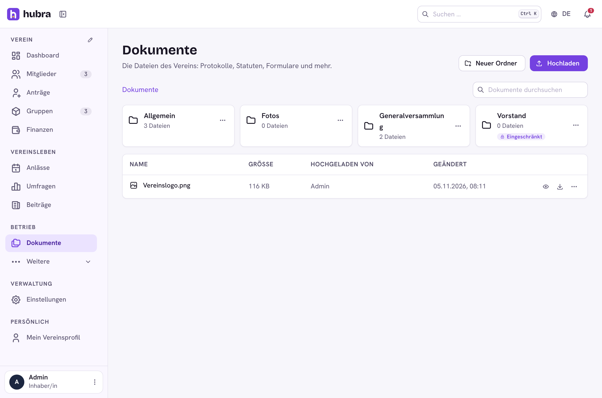
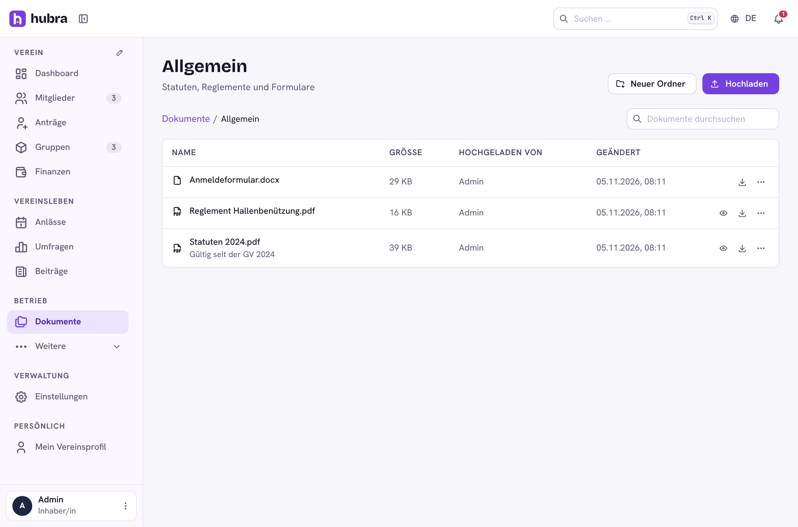
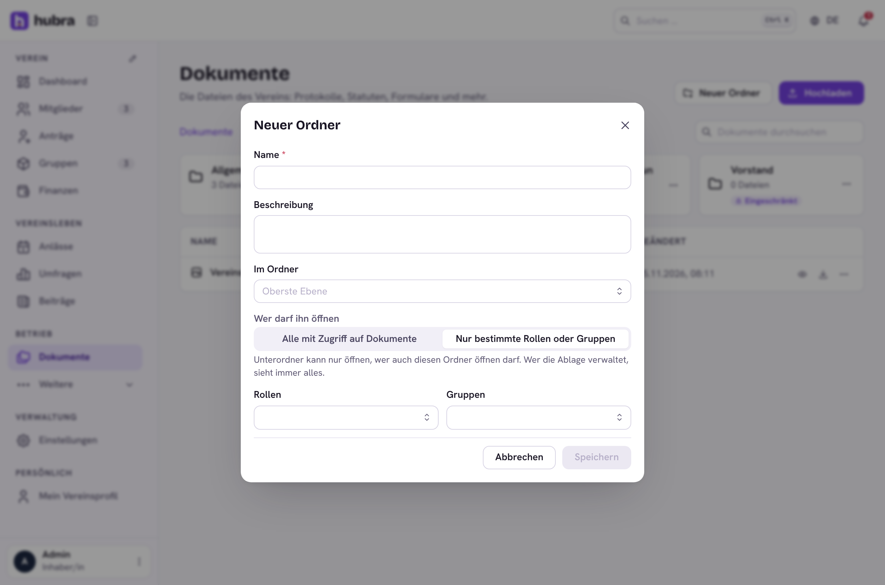

# Hubra plugin: Documents

[](https://github.com/hubra-app/hubra-plugin-documents/actions/workflows/release.yml?query=branch%3Amain) [](https://buymeacoffee.com/bitsandbricks)

The club's document library for [Hubra](https://hubra.club): folders, uploads
and access per role or group.

**Plugin id** `documents` · **Package** `hubra_documents` · **Module** `documents` · **Needs** Hubra with the file store (`hubra.core.files`, hubra-app/hubra#197)



## What it does

- **Folders**, nested as deep as you like. Each folder is open to everyone
  who may read documents, or only to the roles and groups it names. A
  subfolder is only open to whoever may open the folder above it too, so
  "Vorstand / Finanzen" stays with the board without a list of its own.
- **Files**: upload several at once, rename, move to another folder, upload
  a new version (replaces the old one), delete. PDFs, images and text files
  open in the browser, sandboxed; anything else (HTML, SVG, Office files)
  always downloads.
- **Search** over the names and descriptions of the files you may open, on
  the page and in the app's search (Ctrl K).
- Every upload, change and deletion is in the club's audit log.

| Permission | Who it is for |
| --- | --- |
| `documents.files.read` | see the library, the folders open to you |
| `documents.files.write` | upload; rename, move, replace and delete your own files |
| `documents.folders.manage` | create folders and set their access; change any file; sees every folder |

## Where the files are

In Hubra's file store, which the platform sets up (manage › Backups ›
Storage › File storage): an S3 bucket, or a folder on the server. Each file
is encrypted with the club's key before it is stored, counts towards the
club's storage and is deleted with the club. The platform's `files.max_mb`
(default 25 MB) is the largest file.

## Screenshots

| Folder | Access of a folder |
| --- | --- |
|  |  |

Dark mode and phone: [dark](docs/screenshots/docs-dark.png), [phone](docs/screenshots/docs-phone.png).

## Develop

Clone it into `plugins/documents` of a Hubra checkout, then:

```sh
cd app/backend && pytest ../../plugins/documents
cd app/frontend && npm run typecheck:plugins && npm run build:plugin -- ../../plugins/documents
```
Bump `version` in `plugin.yaml`, add a `## <version>` section to
`CHANGELOG.md` and merge. Then tag the merged commit on main and push the tag:

```sh
git switch main && git pull
git tag v<version> && git push origin v<version>
```

The workflow tests the plugin and builds its frontend, the `plugin-signing`
job signs it after your approval, and only then is the GitHub release
`v<version>` published, with `<id>-<version>.zip` and its `.sha256` attached. Files
listed in `.releaseignore` stay out of the zip. Releases are immutable, so a
published version never changes: fix a bad one with a new version. The template itself is never signed.

Releases: bump `version` in `plugin.yaml`, add a `CHANGELOG.md` section,
publish a GitHub release `v<version>`; the workflow tests, signs (after
approval in `plugin-signing`) and attaches the zip.
